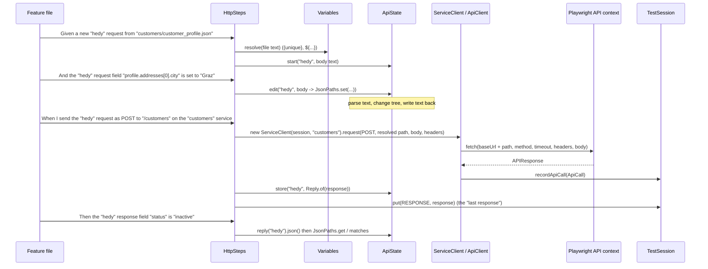

# How the API steps work

This page explains what happens inside the API step definitions: how Cucumber connects them, where requests and
responses are stored, what one HTTP call goes through, and how values move between steps, step classes and the
browser. For the list of every step with examples, see [api-requests.md](api-requests.md).

## Three kinds of API steps

| Step class | Style | Example | Use it for |
|---|---|---|---|
| [`CustomerApiSteps`](../src/test/java/com/agenticqa/steps/CustomerApiSteps.java) | Business steps. Typed `Customer` objects, no JSON in the feature file. | `When I create a customer named "Ada Lovelace"` | Readable happy-path scenarios. The step checks that the call worked (for example 201) on its own. |
| [`CustomerRequestSteps`](../src/test/java/com/agenticqa/steps/CustomerRequestSteps.java) | Customer payload steps. The body is built in the feature file. | `Given the request field "email" is removed` | Validation and negative tests for one endpoint. These steps **do not** check the status, so a 422 can be expected. |
| [`HttpSteps`](../src/test/java/com/agenticqa/steps/HttpSteps.java) | Generic steps. Any service, any method, any path. Requests have names. | `When I send the "order" request as POST to "/orders" on the "orders" service` | New endpoints and services with no Java, chained calls, large payloads. |

All three use the same shared state (described below), so one scenario can mix them freely. For example,
`generic_http_requests.feature` builds the `"customer"` request with a customer step, changes it with a generic
step, and reads its response with both.

## Wiring: glue and PicoContainer

[`TestRunner`](../src/test/java/com/agenticqa/runner/TestRunner.java) sets the glue to `com.agenticqa.steps` and
`com.agenticqa.hooks`. Cucumber finds every `@Given/@When/@Then` method there. No step class is chosen per
feature file: any step can be used in any scenario.

`cucumber-picocontainer` creates the step classes. At the start of **each scenario** it creates a new instance of
every step class and every class their constructors ask for. Within that scenario it shares one instance of each:

```java
public HttpSteps(TestSession session, ApiState api, Variables vars, ServiceCleanup cleanup) { ... }
public CustomerRequestSteps(TestSession session, ApiState api, Variables vars, CustomerCleanup cleanup) { ... }
```

`HttpSteps` and `CustomerRequestSteps` get the **same** `ApiState` and `Variables`. That is the whole mechanism
for sharing data between step classes. There are no static fields and no thread-locals. Scenarios running in
parallel each get their own objects, so they cannot see each other's data.

| Shared object | Holds | Lives in |
|---|---|---|
| [`TestSession`](../src/main/java/com/agenticqa/core/TestSession.java) | Settings, the Playwright browser context and its API context, the call log, typed values by `DataKey` | `core` |
| [`ApiState`](../src/main/java/com/agenticqa/api/ApiState.java) | Named requests (body text and headers) and named responses | `api` |
| [`Variables`](../src/main/java/com/agenticqa/core/Variables.java) | `${name}` values and the scenario's `{unique}` token | `core` |
| [`ServiceCleanup`](../src/test/java/com/agenticqa/steps/ServiceCleanup.java) | DELETEs to run after the scenario, on any service | `steps` |
| [`CustomerCleanup`](../src/test/java/com/agenticqa/steps/CustomerCleanup.java) | IDs of customers to delete after the scenario | `steps` |

## The life of one request



### 1. Build: `ApiState.start`

Each way of starting a request (from a file, a table, a doc string or an earlier response) ends in
`api.start(name, bodyText)`. This **replaces** any request with that name. The body is kept as **JSON text**, not
as a Java object. That is how a doc string can hold wrong types, extra fields or broken JSON and still be sent
exactly as written.

The table form starts from `{}` and then runs the same code as `the "x" request fields are set:`.

### 2. Change: `ApiState.edit`

Every field step (`set`, `fields are set`, `removed`, `merged with`) calls `api.edit(name, change)`. This method:

1. creates the body as `{}` if the request has none,
2. parses the text with `JsonPaths.parse`. If the body is not valid JSON, it fails with a message that says so,
3. applies the change to the tree (`JsonPaths.set`, `remove` or `merge`),
4. writes the tree back as compact text.

A request can therefore be changed over any number of steps, with other requests built in between. Headers are
stored next to the body (`the "x" request header ... is ...`) and are never part of the JSON.

### 3. Send: `ServiceClient` and `ApiClient.send`

`new ServiceClient(session, "customers")` looks up `services.customers` in the active environment file. An
unknown name fails and lists the configured services. Then
[`ApiClient.send`](../src/main/java/com/agenticqa/api/ApiClient.java) does the same thing for every client, generic
or business:

- **URL**: the service `baseUrl` plus the resolved path.
- **Headers**, merged in this order, so later ones win:
  1. the service's default `headers` from YAML,
  2. `Content-Type: application/json`, only if there is a body and no default already sets it,
  3. the request's own headers.
- **Timeout**: the service `timeoutMs`.
- **Transport**: `session.api()`, the request context of the scenario's **browser context**. API calls and the
  page therefore share cookies. A login done in the browser also applies to API calls, and the other way round.
- **Logging**: one console line, `[API] POST http://... -> 201 (12 ms)`, and an `ApiCall` added to the session's
  call log.

### 4. Remember: named response and last response

After sending, `HttpSteps.remember` stores the response in two places:

| Store | Read by | What it is |
|---|---|---|
| `ApiState` under the request's name (or the `as "name"` of a call without body) | `the "x" response ...` steps, `a new "y" request from the "x" response`, the bridge step | A `Reply` record: a **copy** of status, body and headers, still readable after the browser context closes |
| `TestSession` under `Keys.RESPONSE` | `Then the API responds with status ...` | The raw Playwright `APIResponse` of the **most recent** call from any step class |

Sending the same name again overwrites the earlier response. Use a new name (`hedyRead`, `hedyUpdate`) to keep both.

### 5. Check: `JsonPaths.matches`

Response and request checks read a value by path and compare it with the expectation:

- A plain expectation (`"3"`, `"true"`, `"active"`) is compared with the value's **text**, so it matches the
  number 3 and the string "3". It never matches an object, an array or `null`.
- A `json:` expectation is parsed and compared as **JSON**, so `json:3` matches only the number, and
  `json:{"a":1}` compares a whole object.
- A path that leads nowhere is `null` and never matches. The error message shows the actual value, the expected
  value and the full body.

`the "x" response fields are:` checks every row before it fails, so one run shows every difference.

## Placeholders: when `{unique}` and `${name}` are filled in

`Variables.resolve` runs **when the step runs**, not when the scenario is parsed. A variable can therefore be
used in any step after the step that saved it. These are resolved:

| Resolved | Not resolved |
|---|---|
| Test data files (whole text, before parsing) | Field **paths** (`"items[0].qty"`) |
| Doc strings (`with body:`, `merged with:`) | Request and response **names** |
| Field values and table values | Service names |
| Endpoint paths in send steps | Bodies copied `from the "x" response` (copied as they are) |
| Header values | |
| Expectations | |
| Cleanup paths (resolved when registered) | |

`{unique}` is created the first time it is used and stays the same for the whole scenario. That is how a name
set in a request can be checked again in the response, or searched for on the page. An unknown `${name}` fails
and lists the variables saved so far.

Files and doc strings are resolved as **text** before they are parsed. A variable whose value contains `"`
can therefore break the JSON. To set such a value, use a field step: there the resolved value goes into a
JSON string and is escaped correctly.

Values are saved with `I save the "x" response field "id" as "xId"` (a single value is saved as its text, an
object or array as compact JSON) or `the variable "region" is "eu-{unique}"`.

## The customer steps and the `"customer"` request

`CustomerRequestSteps` is a thin layer over the same `ApiState`. All of its steps use the named request
`"customer"` (`CustomerRequestSteps.REQUEST`):

- `a new customer request from "..."` works like `a new "customer" request from "..."`.
- `the request field "status" is set to "..."` works like `the "customer" request field "status" is set to "..."`.
- `I send the create customer request` POSTs the body text with `CustomerApi.create` and stores the response
  as `"customer"` and as the last response.

On a **201** the create step also does three more things:

1. Tracks the new ID in `CustomerCleanup`.
2. Stores the created `Customer` under `Keys.CUSTOMER`. This is "the customer" that the business steps and the
   UI steps use (`the customer can be found by id ...`, `I search the customers page for that customer`).
3. **Restarts the `"customer"` request from the server's answer, without `id`.** Later edits and
   `I send the update request for the customer` then start from what the server stored, defaults included. This
   is why `the request field "status" is removed` followed by an update resets the status to its default.

### The bridge to the business and UI steps

The generic steps know nothing about customers. Two steps connect them:

- `Given the "hedy" response is the customer` reads a stored response as a `Customer`, puts it under
  `Keys.CUSTOMER` and tracks it for cleanup. Every "the customer" step, API or browser, now works on it.
- `I save the customer's id as "radiaId"` goes the other way. It takes the ID, name, email or status of "the
  customer" (for example one added through the GUI form) and saves it as a variable for the generic steps.

## Cleanup

There are two cleanup classes, both run by PicoContainer for each scenario and both as `@After(order = 20000)`:

- `ServiceCleanup`: `"/orders/${orderId}" on the "orders" service is deleted after the scenario` adds a DELETE
  to a stack. After the scenario the DELETEs run **newest first**, so a resource that depends on another is
  deleted first.
- `CustomerCleanup`: deletes every customer ID tracked by the customer steps and the bridge.

Cucumber runs `@After` hooks with a **higher** order first, so both run before `Hooks.after` (default order
10000) closes the browser context they send their requests through. Both run whether the scenario passed or
failed. Both are best effort: a failing DELETE is ignored, so it cannot hide the real result of the scenario.
Cleanup calls are added to the call log like any other call.

## When a step fails

- Step errors name what exists. A wrong request name lists the requests so far, a wrong response name lists the
  responses, a wrong variable lists the variables, and a wrong path to remove says that nothing is there.
- A failed check shows the actual value, the expected value and the full response body.
- `Hooks.after` attaches the scenario's whole call log as `api-calls`, in order. Each entry has the method, URL,
  status, time and both bodies (each cut to 4000 characters). See [reporting.md](reporting.md).

## Adding API steps for a new service

**No Java needed, in most cases.** Two YAML entries cover a new service and its endpoints:

1. The service under `services:` in each environment file (base URL, headers, timeout).
2. Its endpoints in `src/main/resources/endpoints/<service>.yaml`, one line each:

   ```yaml
   service: orders
   endpoints:
     create: { method: POST, path: /orders, body: orders/new_order.json }
     get:    { method: GET,  path: "/orders/{id}" }
   ```

Feature files then use the generic steps: `Given a new "order" request for "orders.create"`,
`When I call "orders.create" with the "order" request`, `When I call "orders.get" as "read" with: | id | ${orderId} |`.
See [api-requests.md](api-requests.md#endpoint-catalog-call-endpoints-by-name).

**Business steps**, when the same operation is used in many scenarios and should read like a business action.
They still need no client class, request record or `withX` method: use `EndpointClient` and `Payload`.

```java
public class OrderSteps {
    private final TestSession session;
    private final EndpointClient api;
    private final ServiceCleanup cleanup;

    public OrderSteps(TestSession session, ServiceCleanup cleanup) {   // PicoContainer injects these
        this.session = session;
        this.api = new EndpointClient(session);
        this.cleanup = cleanup;
    }

    @When("I place an order for {int} items")
    public void placeOrder(int items) {
        Payload order = Payload.file("orders/new_order.json").set("items[0].quantity", items);
        APIResponse response = api.call("orders.create", order);
        session.put(Keys.RESPONSE, response);          // so "the API responds with status ..." works
        assertEquals(response.status(), 201, response.text());
        String id = Payload.of(response).get("id").asText();
        cleanup.delete("orders", "/orders/" + id);
    }
}
```

To let the generic steps read its responses too, also store them in `ApiState`
(`api.store("order", Reply.of(response))`), as `CustomerRequestSteps.remember` does.

A small facade such as [`CustomerApi`](../src/main/java/com/agenticqa/api/CustomerApi.java) (one-line methods
over `EndpointClient`) is optional. It is worth having only for the few operations that many steps call.
