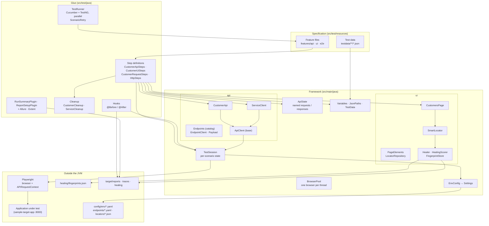
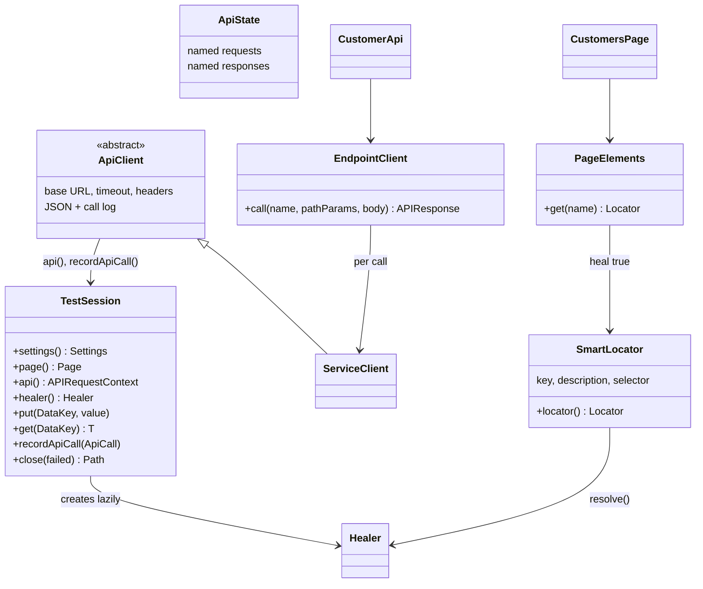
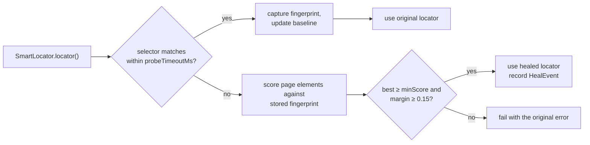
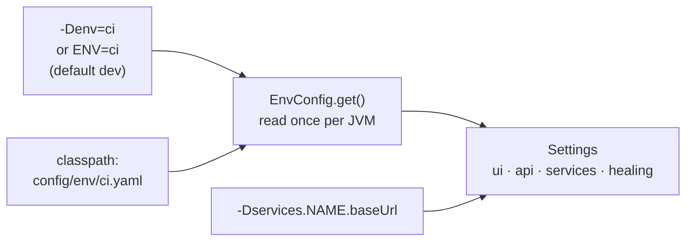
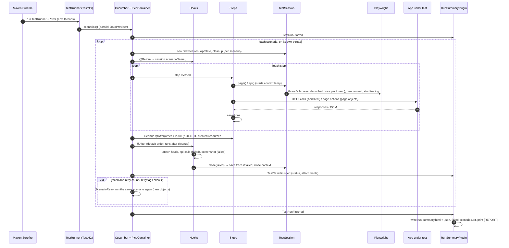
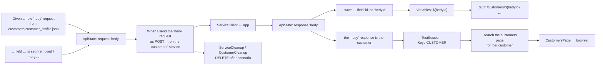
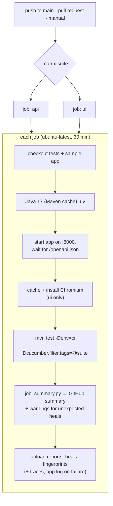

# Architecture and workflow

This page explains how the framework is built, how its parts fit together, and what happens from
`mvn test` to the final report. For details on specific features, see
[api-requests.md](api-requests.md), [healing.md](healing.md) and [reporting.md](reporting.md).

## Design principles

1. **One scenario, one session.** Everything a scenario uses (browser, page, API context, stored data,
   requests, responses, healer, call log) belongs to that scenario only. That is what makes parallel runs safe.
2. **Feature files describe behaviour, Java describes how.** Steps read like requirements. Selectors, URLs
   and JSON handling live in page objects, API clients and helpers, each in one place.
3. **API and UI share one browser context.** HTTP calls and the page share cookies, so a login done through one is
   valid for the other.
4. **Config, not code, for environments and services.** URLs, timeouts, headers and healing settings come
   from `config/env/<env>.yaml` and can be overridden per run.
5. **Failures carry their evidence.** Screenshot, trace, HTTP call log and heal events are attached
   automatically. No step has to remember to collect them.
6. **Tests clean up after themselves**, whether they pass or fail.

## Layers

| Layer | Package / folder | Responsibility |
|---|---|---|
| Specification | `features/`, `testdata/` | What is tested, in Gherkin, plus the JSON payloads it uses |
| Runner | `runner.TestRunner` | Finds the features, wires glue and plugins, runs scenarios in parallel through a TestNG `DataProvider` |
| Hooks | `hooks.Hooks` | Names the session before each scenario. After it, attaches heals, the HTTP log and a screenshot, then closes the session |
| Steps | `steps.*` | Turn Gherkin into calls on page objects, clients and `ApiState`. No selectors and no raw URLs |
| Cleanup | `CustomerCleanup`, `ServiceCleanup` | Delete what the scenario created, newest first, in `@After` |
| Session | `core.TestSession` | Lazily starts Playwright, holds the page, API context, healer, typed data store and call log |
| Data helpers | `core.Variables`, `JsonPaths`, `TestData`, `DataKey` | `${var}` and `{unique}` substitution, JSON path read and write and merge, loading test data, typed keys |
| API | `api.*` | `ApiClient` handles URLs, timeouts, default headers, JSON and logging. Subclasses describe business operations |
| UI | `ui.*` | Page objects built from `SmartLocator`s |
| Healing | `ui.healing.*` | Fingerprint capture, similarity scoring and replacement of broken selectors |
| Config | `config.*` | Loads `config/env/<env>.yaml` once per JVM into a typed `Settings` record |
| Reporting | `reporting.RunSummaryPlugin` | Cucumber event listener that writes `run-summary.html` and `.json` |

## Key components

### TestSession, the scenario's context

PicoContainer creates one `TestSession` per scenario and injects the same instance into every step class,
hook and cleanup class that asks for it in its constructor.

- **The context starts lazily.** `page()` or `api()` opens a new browser context the first time it is called,
  in the browser of the current worker thread (`BrowserPool`). Each worker thread launches its browser once and
  reuses it for all its scenarios, while every scenario still gets its own context (cookies, storage, trace).
  A pure API scenario also creates a context, because the API context comes from it, but it never opens a page.
- **Tracing** starts with the context and is saved to `target/artifacts/traces/` only when the scenario fails.
- **The typed store** (`put`/`get` with a `DataKey<T>`) lets step classes share values such as "the current
  customer" without static fields.

### API access

`ApiClient` is the single place where HTTP happens:

1. It resolves the service from `Settings.service(name)`: base URL (which `-Dservices.NAME.baseUrl` can
   override), timeout and default headers.
2. It sends the request through `session.api()`, so cookies are shared with the page.
3. It records an `ApiCall` (method, URL, status, time, request and response bodies) in the session's call log.
   If the scenario fails, the log is attached to the report.

Clients on top of it:

- **`EndpointClient`** calls any endpoint of the catalog (`src/main/resources/endpoints/<service>.yaml`) by
  name, for example `call("customers.get", Map.of("id", 42))`. Bodies are `Payload`s (any JSON, edited by
  path), so no request class or method is needed per endpoint.
- **`CustomerApi`** is an optional facade of one-line methods over `EndpointClient`, for the operations the
  readable customer steps use many times.
- **`ServiceClient`** sends any method to any path of a configured service. It is used by the generic
  `HttpSteps` together with `ApiState` (named requests and responses), `JsonPaths` and `Variables`.

### UI access and self-healing

Page objects hold `SmartLocator`s. Every time `locator()` is called:

The full algorithm is in [healing.md](healing.md).

### Configuration

## Workflow: what happens on `mvn test`

### Scenario lifecycle in words

1. **Discovery.** `TestRunner` points Cucumber at `src/test/resources/features`, with glue
   `com.agenticqa.steps` and `com.agenticqa.hooks`. Tags (`-Dcucumber.filter.tags`) select scenarios.
2. **Scheduling.** The overridden `scenarios()` `DataProvider` is `parallel = true`, and Surefire passes
   `dataproviderthreadcount = ${threads}`, so up to N scenarios run at once.
3. **Wiring.** For each scenario, PicoContainer builds a fresh object graph: `TestSession`, `ApiState`, the step
   classes and the cleanup classes. Classes that ask for the same type get the same instance.
4. **Before.** `Hooks.before` stores the scenario name, which is used for trace file names.
5. **Steps.** Steps call page objects and API clients. The first call to the browser or the API starts Playwright
   with the configured browser, headless mode, base URL, timeout and tracing.
6. **After.** First, the cleanup classes (`@After(order = 20000)`; for `@After` hooks a higher order runs first)
   delete the resources the scenario registered, newest first, while the session is still open. Then
   `Hooks.after` attaches heal events (always), the HTTP call log and a full-page screenshot (on failure only),
   and closes the session. The trace is saved only on failure.
7. **Reporting.** Cucumber's `pretty`, `html` and `json` plugins and `RunSummaryPlugin` collect events
   throughout the run. At the end, `RunSummaryPlugin` writes the summary.

### Data flow inside a mixed API and UI scenario

## CI workflow

Suites are independent jobs with their own app instance, and `fail-fast: false` means one failing suite
doesn't cancel the other. A newer push to the same branch cancels the run that is still in progress.

## Extension points

| You want to… | Change |
|---|---|
| Test a new endpoint | One line in `endpoints/<service>.yaml`, then the generic steps (`When I call "..."`) |
| Talk to a new microservice | Add an entry under `services:` in each `config/env/*.yaml` and an `endpoints/<service>.yaml` |
| Add business-level API steps | A step class using `EndpointClient` and `Payload`, taking `TestSession` in its constructor |
| Test a new page | Add `locators/<page>.json`, a page object using `PageElements`, plus a step class |
| Share data between step classes | Add a `DataKey` in `steps/Keys.java` and use `session.put` / `get` |
| Add an environment | Add `config/env/<name>.yaml` (copy `test.yaml`) and run with `-Denv=<name>` |
| Retry more or fewer scenarios | `retry.count` / `retry.tags` in the env file, or `-Dretry.count` / `-Dretry.tags` |
| Add a report output | Add a plugin to `@CucumberOptions(plugin = …)` in `TestRunner` |
| Add a CI suite | Add the tag to `matrix.suite` in `tests.yml` |

## Known limits

- Bodies are JSON only. Form-encoded, multipart and XML bodies would need their own steps.
- JSON paths use a small, strict syntax, not full JSONPath (no filters or wildcards).
- One browser runs per worker thread. Scenarios are isolated by browser contexts, not by processes, so a
  browser crash affects the scenario running in it (the next scenario gets a new browser). Use `-Dthreads` to
  match the machine.
- Extent and `cucumber.html` show each retry attempt as its own entry. The run summary and Allure group them.
- The sample app is a single service, so the multi-service features are shown with only the `customers` service.
