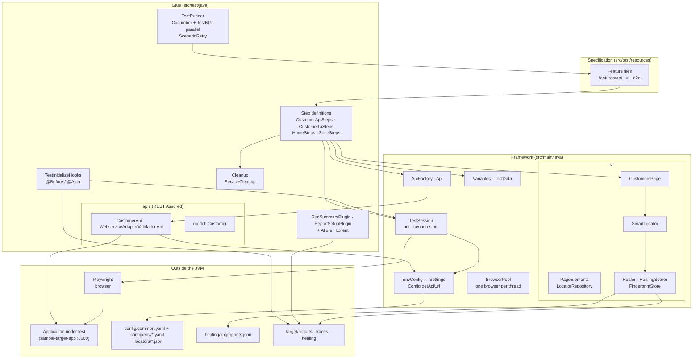
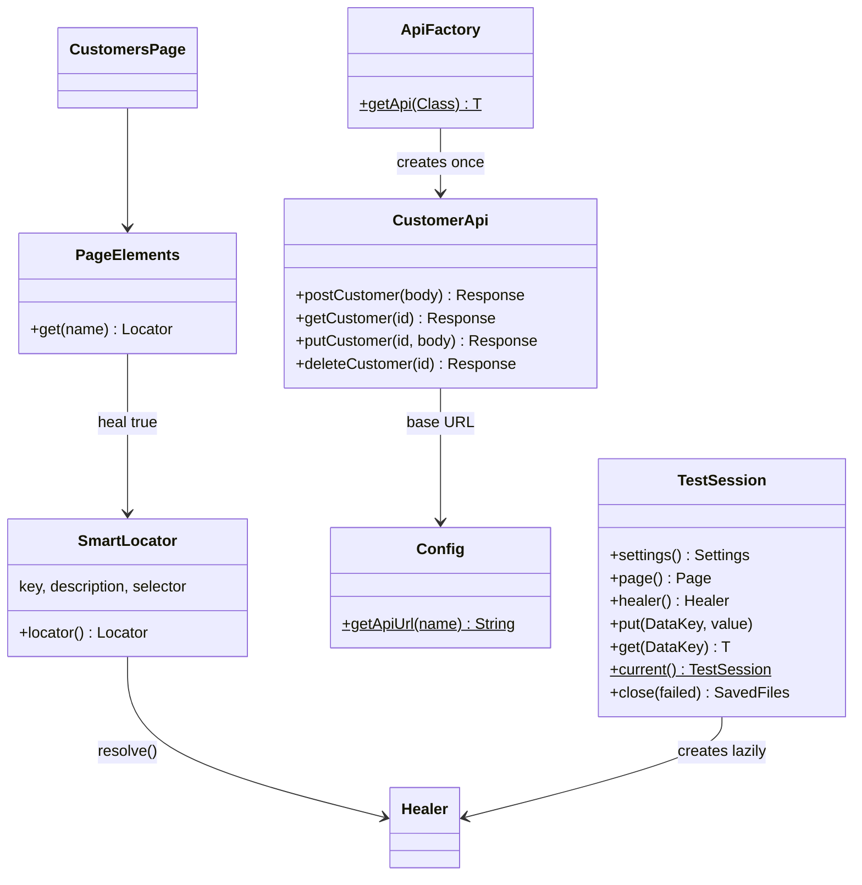
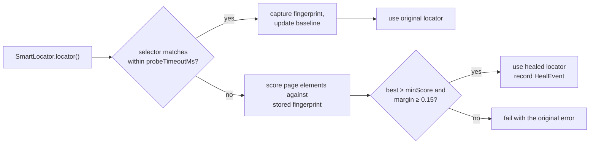
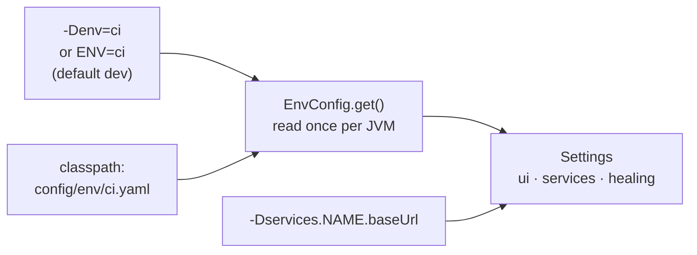
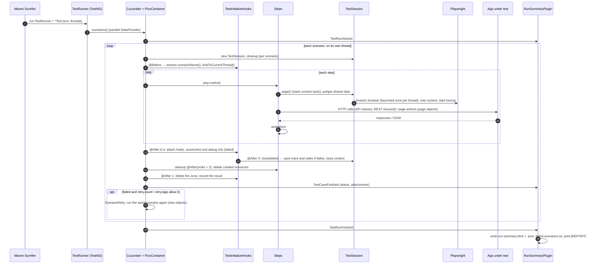
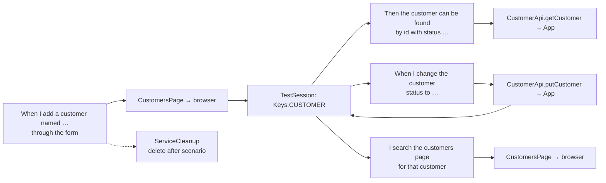
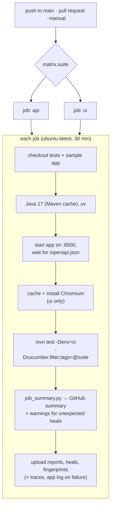

# Architecture and workflow

This page explains how the framework is built, how its parts fit together, and what happens from
`mvn test` to the final report. For details on specific features, see
[api.md](api.md), [healing.md](healing.md) and [reporting.md](reporting.md).

## Design principles

1. **One scenario, one session.** Everything a scenario uses (browser, page, stored data, healer) belongs to
   that scenario only. That is what makes parallel runs safe.
2. **Feature files describe behaviour, Java describes how.** Steps read like requirements. Selectors live in
   locator files and page objects, HTTP calls in API classes, each in one place.
3. **API and UI share data through the session.** An API step stores what it created in the `TestSession`, and
   a GUI step of the same scenario reads it, and the other way round.
4. **Config, not code, for environments and services.** The UI URL, the base URL of every service, waits and
   healing settings come from `config/env/<env>.yaml` and can be overridden per run.
5. **Failures carry their evidence.** Screenshot, trace, video and heal events are attached automatically. No
   step has to remember to collect them.
6. **Tests clean up after themselves**, whether they pass or fail.

## Layers

| Layer | Package / folder | Responsibility |
|---|---|---|
| Specification | `features/` | What is tested, in Gherkin |
| Runner | `runner.TestRunner` | Finds the features, wires glue and plugins, runs scenarios in parallel through a TestNG `DataProvider` |
| TestInitializeHooks | `hooks.TestInitializeHooks` | Names the session and binds it to the thread before each scenario. After it, attaches heals and a screenshot, then closes the session |
| Steps | `steps.*` | Turn Gherkin into calls on page objects and API classes. No selectors and no raw URLs |
| Cleanup | `ServiceCleanup` | Delete what the scenario created, newest first, in `@After` |
| Session | `core.TestSession` | Lazily starts Playwright, holds the page, healer and the typed data store shared by API and GUI steps |
| Data helpers | `core.Variables`, `TestData`, `DataKey` | `${var}` and `{unique}` substitution, unique test data, typed keys |
| API | `api.ApiFactory`, `apis.*` | `ApiFactory` creates each API class once; API classes call their service with REST Assured |
| UI | `ui.*` | Page objects built from `SmartLocator`s |
| Healing | `ui.healing.*` | Fingerprint capture, similarity scoring and replacement of broken selectors |
| Config | `config.*` | Loads `config/env/<env>.yaml` once per JVM into a typed `Settings` record; `Config.getApiUrl` for API classes |
| Reporting | `reporting.RunSummaryPlugin` | Cucumber event listener that writes `run-summary.html` and `.json` |

## Key components

### TestSession, the scenario's context

PicoContainer creates one `TestSession` per scenario and injects the same instance into every step class,
hook and cleanup class that asks for it in its constructor.

- **The context starts lazily.** `page()` opens a new browser context the first time it is called, in the
  browser of the current worker thread (`BrowserPool`). Each worker thread launches its browser once and reuses
  it for all its scenarios, while every scenario still gets its own context (cookies, storage, trace). An
  API-only scenario never starts a browser.
- **Tracing** starts with the context and is saved to `target/artifacts/traces/` only when the scenario fails.
- **Video** is recorded with the context (`ui.video`, default `failed`) and kept in `target/artifacts/videos/` only
  when the scenario fails; passed scenarios' videos are deleted. `ui.ignoreHttpsErrors` and `ui.maximize` are
  context options too, so every page of the scenario gets them.
- **The typed store** (`put`/`get` with a `DataKey<T>`) lets step classes share values such as "the current
  customer" without static fields, between API and GUI steps alike.

### API access

API classes are written as in the existing framework (see [api.md](api.md)):

1. An API class (`apis/CustomerApi`) implements `Api` and has a no-argument constructor that reads its base URL
   with `Config.getApiUrl("customers")`, which `-Dservices.customers.baseUrl` can override.
2. Each method calls the service with REST Assured, fails with `Assert.fail` on an unexpected status and returns
   the `Response`. Bodies are model classes (`apis/model/Customer`), serialized by Jackson.
3. Steps get the class with `ApiFactory.getApi(CustomerApi.class)`, which creates it once and returns the same
   instance for the whole run, so API classes hold no per-scenario state.

### UI access and self-healing

Page objects hold `SmartLocator`s. Every time `locator()` is called:

The full algorithm is in [healing.md](healing.md).

### Configuration

## Workflow: what happens on `mvn test`

### Scenario lifecycle in words

1. **Discovery.** `TestRunner` points Cucumber at `src/test/resources/features`, with glue
   `com.agenticqa.steps` and `com.agenticqa.hooks`. Tags (`-Dcucumber.filter.tags`) select scenarios.
2. **Scheduling.** The overridden `scenarios()` `DataProvider` is `parallel = true`, and Surefire passes
   `dataproviderthreadcount = ${threads}`, so up to N scenarios run at once.
3. **Wiring.** For each scenario, PicoContainer builds a fresh object graph: `TestSession`, the step classes and
   the cleanup class. Classes that ask for the same type get the same instance.
4. **Before.** `TestInitializeHooks.bindSession` stores the scenario name, which is used for trace file names, and binds the session
   to the thread for `TestSession.current()`.
5. **Steps.** Steps call page objects and API classes. The first call to the browser starts Playwright with the
   configured browser, headless mode, base URL, timeout and tracing.
6. **After.** For `@After` hooks a higher order runs first. First the evidence, while the page is still open:
   `TestInitializeHooks` attaches heal events (always), and on failure a full-page screenshot and the debug
   information. Then `closeBrowser` closes the session; the trace and video are kept only on failure. Then the
   cleanup classes (`@After(order = 2)`) delete the resources the scenario registered, newest first, and last
   `teardownData` (1) deletes the zone and records the result.
7. **Reporting.** Cucumber's `pretty`, `html` and `json` plugins and `RunSummaryPlugin` collect events
   throughout the run. At the end, `RunSummaryPlugin` writes the summary.

### Data flow inside a mixed API and UI scenario

## CI workflow

Suites are independent jobs with their own app instance, and `fail-fast: false` means one failing suite
doesn't cancel the other. A newer push to the same branch cancels the run that is still in progress.

## Extension points

| You want to… | Change |
|---|---|
| Test a new endpoint | A method on the service's API class in `apis/`, then a step that calls it |
| Talk to a new microservice | Its `baseUrl` under `services:` in each `config/env/*.yaml`, an API class in `apis/` and its models in `apis/model/` |
| Add API steps | A step class using `ApiFactory.getApi(XxxApi.class)`, storing results in the `TestSession` |
| Test a new page | Add `locators/<page>.json`, a page object using `PageElements`, plus a step class |
| Share data between step classes | Add a `DataKey` in `steps/Keys.java` and use `session.put` / `get` |
| Add an environment | Add `config/env/<name>.yaml` (copy `test.yaml`) and run with `-Denv=<name>` |
| Retry more or fewer scenarios | `retry.count` / `retry.tags` in the env file, or `-Dretry.count` / `-Dretry.tags` |
| Add a report output | Add a plugin to `@CucumberOptions(plugin = …)` in `TestRunner` |
| Add a CI suite | Add the tag to `matrix.suite` in `tests.yml` |

## Known limits

- API calls do not go through the browser context, so they do not share the browser's cookies or login.
- One browser runs per worker thread. Scenarios are isolated by browser contexts, not by processes, so a
  browser crash affects the scenario running in it (the next scenario gets a new browser). Use `-Dthreads` to
  match the machine.
- Extent and `cucumber.html` show each retry attempt as its own entry. The run summary and Allure group them.
- The sample app is a single service. `WebserviceAdapterValidationApi` shows a second service's API class, but
  no scenario calls it, because the sample app has no such endpoint.
