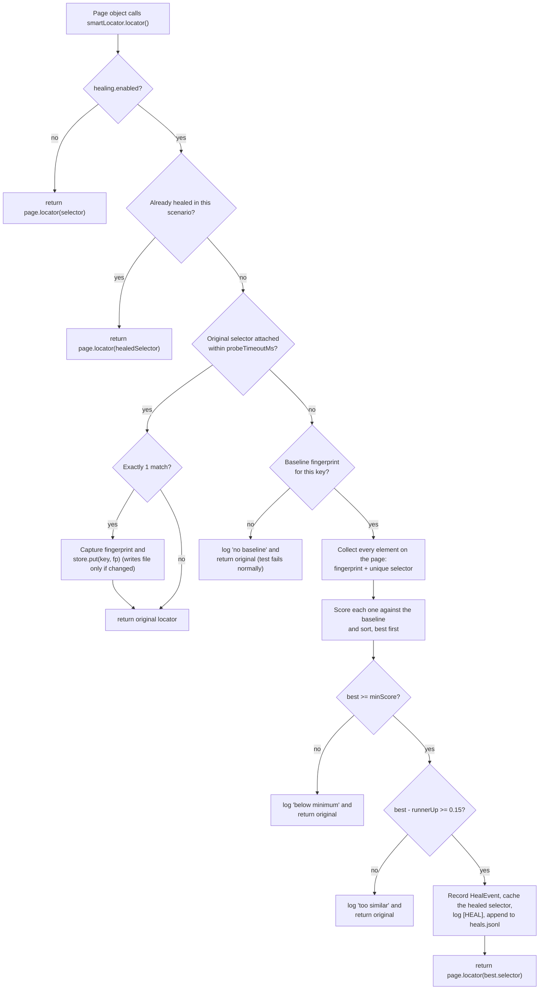

# Self-healing locators

When a page object's selector stops matching (say a release renamed `#search-input` to `#customer-search`), the framework finds the element anyway. It compares what is on the page with a **fingerprint** of the element, saved the last time the selector worked. The test keeps running, and the heal is reported in several places so someone updates the page object.

Healing does not replace fixing selectors. It keeps one renamed id from failing the whole suite, and it tells you exactly what to fix.

## The pieces

| Class / file | Role |
|---|---|
| [`SmartLocator`](../src/main/java/com/agenticqa/ui/healing/SmartLocator.java) | One element of a page object: a stable **key** (`customers.searchInput`), a readable **description** (`search input`) and the **selector** to try first. `locator()` asks the healer to resolve it on every use. |
| [`Healer`](../src/main/java/com/agenticqa/ui/healing/Healer.java) | The engine. There is one per scenario, created by `TestSession.healer()`. It decides between "selector works", "heal" and "give up". |
| [`Fingerprint`](../src/main/java/com/agenticqa/ui/healing/Fingerprint.java) | What an element looked like: tag, id, name, type, placeholder, aria-label, text, classes. It also holds the JavaScript (`CAPTURE_JS`) that reads these values in the browser. |
| [`FingerprintStore`](../src/main/java/com/agenticqa/ui/healing/FingerprintStore.java) | The baseline: one JSON file, [`healing/fingerprints.json`](../healing/fingerprints.json), shared by every scenario in the JVM. |
| [`HealingScorer`](../src/main/java/com/agenticqa/ui/healing/HealingScorer.java) | Pure scoring logic, no browser: how similar is a page element to the stored fingerprint (0..1). It is unit tested in `HealingScorerTest`. |
| [`HealEvent`](../src/main/java/com/agenticqa/ui/healing/HealEvent.java) | The record of one heal: old and new selector, score, runner-up score, URL and time. |

## Configuration

Each environment file (`src/main/resources/config/env/dev.yaml`, `ci.yaml`) has a `healing` section. If the section is missing, `Settings.Healing.defaults()` gives the same values:

```yaml
healing:
  enabled: true                               # false = every SmartLocator behaves like a plain Playwright locator
  probeTimeoutMs: 2000                        # how long the original selector may take to appear before healing starts
  minScore: 0.6                               # lowest similarity accepted for a replacement
  fingerprintsFile: healing/fingerprints.json # the baseline (keep it in git)
  reportFile: target/healing/heals.jsonl      # one JSON line appended per heal
```

One rule is hard-coded: `Healer.MIN_MARGIN = 0.15`. The best candidate must beat the second best by at least this much.

## Complete flow



### 1. Resolving a locator (`Healer.resolve`)

Page objects call `locator()` every time they use an element, for example `searchInput.locator().fill(text)`. They never call it once in a constructor, because the lookup must run against the page as it is now.

1. **Healing off.** The plain `page.locator(selector)` is returned. Nothing is captured.
2. **Already healed in this scenario.** The cached replacement selector is returned at once, so the probe wait is paid only once per element per scenario. The cache lives in the `Healer`, so the next scenario starts clean.
3. **Probe.** `locator.first().waitFor(ATTACHED, probeTimeoutMs)` checks whether the selector matches anything at all.
   - **It matches.** If it matches *exactly one* element, the fingerprint is captured and saved (see below). In both cases the original locator is returned. When there are several matches the fingerprint is not captured, because it would be unclear which element is meant.
   - **It matches nothing within the timeout.** Healing starts.

### 2. Fingerprint capture: how the baseline is built

`Fingerprint.CAPTURE_JS` runs in the browser on the matched element and returns:

| Field | Source | Notes |
|---|---|---|
| `tag` | `tagName`, lowercased | |
| `id` | `el.id` | |
| `name`, `type`, `placeholder`, `ariaLabel` | the attributes | trimmed, blank → `null` |
| `text` | `innerText` | whitespace collapsed, cut to 80 characters; always `null` for `input`, `textarea` and `select` |
| `classes` | `classList` | |

Empty values are left out of the JSON (`@JsonInclude(NON_EMPTY)`), and the scorer ignores them. For example, the search input:

```json
"customers.searchInput" : {
  "tag" : "input",
  "id" : "search-input",
  "name" : "q",
  "type" : "text",
  "placeholder" : "Search by name"
}
```

How `FingerprintStore` behaves:

- **One instance per JVM.** The first `FingerprintStore.at(file)` call decides the file. It is read once at startup, or starts empty if the file does not exist.
- **Thread-safe.** Every method is `synchronized`, because scenarios run in parallel.
- **Writes only on change.** `put` does nothing when the new fingerprint equals the stored one. Otherwise it rewrites the whole file, with keys sorted so diffs stay clean in git.
- **Always the last good state.** Each successful lookup refreshes the baseline, so small, gradual changes (a new class, a reworded label) are absorbed step by step. Then a later rename is compared against a recent picture of the element, not an old one.
- **Heals never write to the baseline.** A healed element is not captured, so the baseline keeps describing the element the page object *means* until someone fixes the selector. After the fix, the next passing run captures the new fingerprint.

> Keep `healing/fingerprints.json` under version control. It is the reference healing compares against. In a fresh checkout without it, nothing can heal until each element has worked at least once.

### 3. Collecting candidates (`Healer.CANDIDATES_JS`)

When the selector fails, one `page.evaluate` call goes through `document.body.querySelectorAll('*')`. It skips `script`, `style` and `template` and stops after 3000 elements. For each element it returns:

- its **fingerprint**, from the same `CAPTURE_JS`, so stored and live values are always computed the same way, and
- a **selector that finds exactly that element**, built in this order of preference:
  1. `#id`, if that id is unique on the page
  2. `tag[name="…"]`, if that is unique
  3. a `tag:nth-of-type(n) > …` path that climbs to the nearest ancestor with a unique id (or up to `<body>`)

The new selector reported in a heal is therefore usually a clean `#id`. On pages without ids it may be a positional path, which is a good reason to update the page object soon rather than rely on the heal.

### 4. Scoring (`HealingScorer.score`)

Each candidate is compared with the stored fingerprint, one property at a time. **Only properties that the stored fingerprint has count.** A missing expected value adds nothing to either side of the fraction.

| Property | Weight | Comparison |
|---|---|---|
| `id` | 3 | words |
| `name` | 3 | words |
| `placeholder` | 2 | words |
| `ariaLabel` | 2 | words |
| `text` | 2 | words |
| `tag` | 1 | exact, case-insensitive |
| `type` | 1 | exact, case-insensitive |
| `classes` | 1 | set overlap |

- **exact**: full weight if equal, 0 otherwise.
- **words**: full weight if equal (ignoring case). Otherwise `weight × Jaccard` of the two word sets. Values are split into lowercase words at any non-alphanumeric character, so `search-input` → `{search, input}`. This is how a renamed id still earns partial credit.
- **set overlap**: `weight × Jaccard` of the class lists.

```
score = Σ matched weight / Σ weight of the properties the baseline has      (0 if the baseline is empty)
```

Jaccard index = |A ∩ B| / |A ∪ B|.

### 5. Deciding: heal or give up

Candidates are sorted best first. The best one is used only if **both** safety checks pass:

1. **Good enough:** `best.score >= minScore` (0.6).
2. **Clearly the best:** `best.score − runnerUp.score >= 0.15`. Without this, the framework might pick one of two similar fields, which is worse than failing.

If either check fails, if there is no baseline for the key, or if the page has no elements, the healer logs why (`[HEAL] cannot heal …`) and returns the **original** locator. The test then fails with Playwright's normal "element not found" error, exactly as it would without healing.

On success the healer:

1. creates a `HealEvent` (scores rounded to 2 decimals),
2. caches `key → newSelector` for the rest of the scenario,
3. prints `[HEAL] HEALED search input: '#search-input' -> '#customer-search' (score 0.80, runner-up 0.27) on http://…`,
4. appends the event as one JSON line to `target/healing/heals.jsonl`. The write is synchronized on the class, because all scenarios share the file.
5. returns `page.locator(newSelector)`, and the step continues.

## Worked examples

These are the two scenarios in [`self_healing.feature`](../src/test/resources/features/ui/self_healing.feature). The step `the app's HTML renames the id "X" to "Y"` installs a Playwright route that rewrites every HTML document the browser loads in that scenario. It simulates a release; the app itself is not changed.

### Search input: `#search-input` → `#customer-search`

Baseline: `input`, id `search-input`, name `q`, type `text`, placeholder `Search by name`. Total weight = 1 + 3 + 3 + 1 + 2 = **10**.

| Property (weight) | `#customer-search` | `#new-customer-name` (runner-up) |
|---|---|---|
| tag (1) | input ✔ → 1 | input ✔ → 1 |
| id (3) | {search,input} vs {customer,search} → 1/3 → 1.00 | no common word → 0 |
| name (3) | `q` ✔ → 3 | `name` ✘ → 0 |
| type (1) | text ✔ → 1 | text ✔ → 1 |
| placeholder (2) | equal → 2 | {search,by,name} vs {name} → 1/3 → 0.67 |
| **score** | **8 / 10 = 0.80** | **2.67 / 10 = 0.27** |

0.80 ≥ 0.6 and the margin 0.53 ≥ 0.15, so the heal goes ahead.

### Add button: `#add-customer-button` → `#create-customer`

Baseline: `button`, id `add-customer-button`, type `submit`, text `Add Customer`. Total weight = 1 + 3 + 1 + 2 = **7**.

| Property (weight) | `#create-customer` | `#search-button` |
|---|---|---|
| tag (1) | 1 | 1 |
| id (3) | {add,customer,button} vs {create,customer} → 1/4 → 0.75 | vs {search,button} → 1/4 → 0.75 |
| type (1) | 1 | 1 |
| text (2) | `Add Customer` ✔ → 2 | `Search` ✘ → 0 |
| **score** | **4.75 / 7 = 0.68** | **2.75 / 7 = 0.39** |

Here the id alone cannot tell the two buttons apart. The visible text decides, and the margin is 0.29. `HealingScorerTest` checks both of these cases, plus "identical scores 1", "a similar-looking neighbour scores low" and "an empty fingerprint scores 0".

## Where heals show up

One heal travels through every reporting layer:

```
Healer ──► console            [HEAL] HEALED …
       ──► target/healing/heals.jsonl        (one JSON line per heal, whole run)
       ──► Healer.events() ──► TestSession.healEvents()
                                   │
              Hooks @After ────────┘  attaches "Locators healed - update the page object: …"
                                      to the scenario (text/plain, name "self-healing")
                                   │
              RunSummaryPlugin ────┘  reads that attachment:
                                        • "Locators healed" tile + "Healed locators" section in run-summary.html
                                        • "healed N" chip on the scenario row
                                        • "heals" count and per-scenario list in run-summary.json
                                        • console line: "[REPORT] … N locator(s) healed …"
                                   │
              .github/scripts/job_summary.py
                                        • "Healed locators" column in the GitHub job summary
                                        • one ::warning:: annotation per unexpected heal
                                          (heals from @healing scenarios are expected and listed separately)
```

CI uploads `target/reports/`, `target/healing/` and `healing/fingerprints.json` as the `reports-<suite>` artifact. You can see what healed and how the baseline changed during the run.

Steps can also assert on heals: `no locator was healed` and `the "<description>" locator was healed to "<selector>"`.

## Using it in a page object

```java
this.searchInput = new SmartLocator(page, healer, "customers.searchInput", "search input", "#search-input");
// ...
searchInput.locator().fill(text);   // resolve on every use
```

- **Key:** stable and unique (`<page>.<element>`). It names the stored fingerprint, so if you rename the key you start over without a baseline.
- **Description:** what people read in logs and reports.
- **Use it only for elements that are always present:** inputs, buttons, links, headings. Things that can legitimately be missing, such as result rows or the "No customers found." message, stay plain Playwright locators (see `CustomersPage.rows` and `noResults`). Otherwise their absence would start a search for a look-alike, and a wrong element could pass an assertion.

## Limits and things to know

- **Cost:** a broken selector costs up to `probeTimeoutMs` (2 s) per element per scenario before healing starts, plus one page scan.
- **Attributes only:** there is no visual or layout matching. An element that changes its id, name *and* text at once will probably not reach 0.6, and the test fails normally.
- **Cached heals are not re-checked:** a healed selector is reused for the rest of the scenario without checking it again.
- **Changing text:** for elements like `customers.pageIndicator` ("Page 1 of 2") the text is part of the fingerprint, so the baseline is rewritten whenever the text differs. That is harmless, but it shows up as churn in `fingerprints.json`.
- **Local runs rewrite the baseline:** `fingerprints.json` changes in your working tree when elements change. Review those diffs like code. They show what the UI looked like when the tests last passed.
- **A heal is a to-do, not a fix:** after a heal, update the selector in the page object. The next green run then refreshes the baseline with the new fingerprint.
