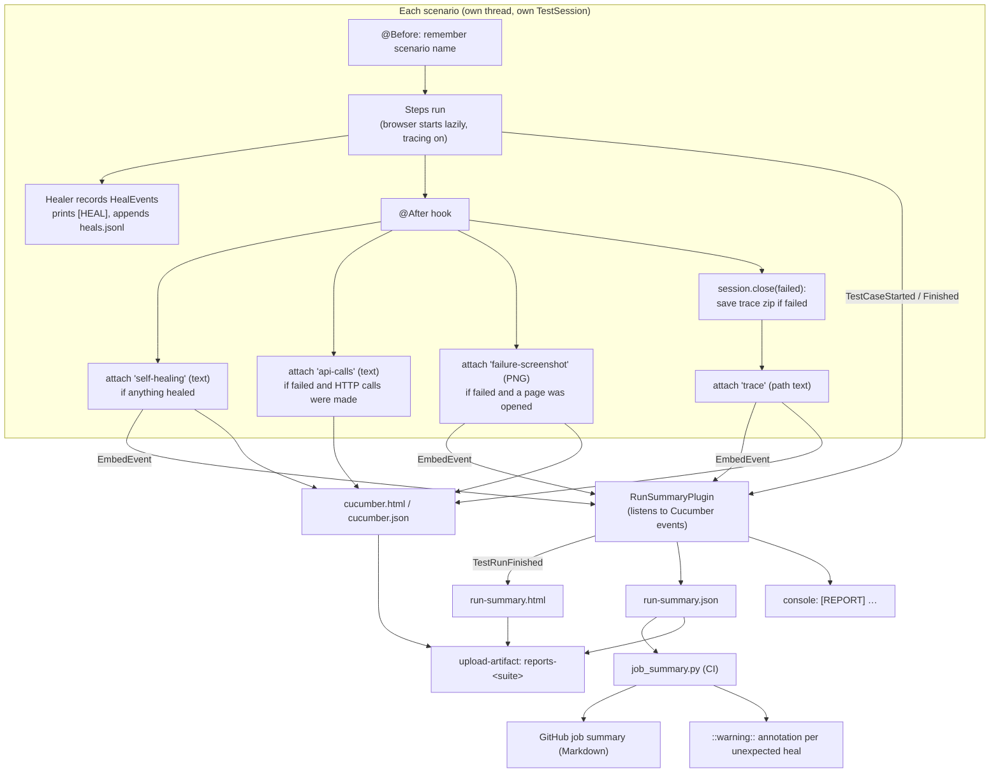

# Reporting

A test run produces evidence at four levels. Each level builds on the one before it:

1. **Per scenario.** The `@After` hook adds healed locators, a failure screenshot and the trace path to the scenario.
2. **Per run.** Cucumber's built-in reports plus our own `RunSummaryPlugin` (`run-summary.html` / `.json` and a console line).
3. **Per CI job.** `job_summary.py` turns the JSON into a GitHub job summary and warning annotations.
4. **Artifacts.** The workflow uploads reports, heal logs, fingerprints, traces and the app log.

Everything is local files under `target/`. No reporting server or extra dependency is involved.

## Output at a glance

| File | Written by | What it is for |
|---|---|---|
| `target/reports/run-summary.html` | `RunSummaryPlugin` | **Start here.** One self-contained page with totals, failures (error, screenshot, trace path), healed locators and every scenario grouped by feature. |
| `target/reports/run-summary.json` | `RunSummaryPlugin` | The same data, machine-readable. Read by CI. |
| `target/reports/cucumber.html` | Cucumber `html` plugin | Every step of every scenario, with all attachments and full stack traces. |
| `target/reports/cucumber.json` | Cucumber `json` plugin | Standard Cucumber JSON for other tools (Allure, Xray, …). |
| `target/artifacts/traces/<time>_<scenario>.zip` | `TestSession.close` | Playwright trace, **failed scenarios only**. |
| `target/healing/heals.jsonl` | `Healer` | One JSON line per healed locator (see [healing.md](healing.md)). |
| `target/surefire-reports/` | Maven Surefire | Plain TestNG results, including unit tests such as `HealingScorerTest`. |
| console | `pretty` plugin, `Healer`, `RunSummaryPlugin` | Steps as they run, `[HEAL]` lines, `Trace saved: …`, and the final `[REPORT]` line. |

All of these are configured in [`TestRunner`](../src/test/java/com/agenticqa/runner/TestRunner.java):

```java
@CucumberOptions(
        plugin = {"pretty", "html:target/reports/cucumber.html", "json:target/reports/cucumber.json",
                "com.agenticqa.reporting.RunSummaryPlugin:target/reports/run-summary.html"}, ...)
```

The text after the colon is passed to the plugin's constructor, so you change the output location there. The JSON file is always written next to the HTML file, with the same base name.

## Complete flow



## 1. Per scenario: what gets collected

### Tracing (always on, kept only on failure)

When a step first needs the page or the API, [`TestSession`](../src/main/java/com/agenticqa/core/TestSession.java) starts the browser and creates its context. It also starts Playwright tracing, with screenshots and DOM snapshots but no sources. API-only scenarios get a context too, because `api()` uses `context().request()`, so they are traced as well.

At the end `session.close(failed)` does one of two things:

- **On failure:** it stops tracing into `target/artifacts/traces/2026-11-09_14-05-09_create-and-find-a-customer.zip`, built from a timestamp and a slug of the scenario name. It prints `Trace saved: …` and returns the path.
- **On a pass:** it stops tracing and throws the trace away, so passing runs leave no zip files behind.

Each close step is wrapped separately, so a cleanup error can never hide the real test result.

To open a trace: `npx playwright show-trace "<path>"`, or drag the zip onto <https://trace.playwright.dev>.

### The `@After` hook ([`Hooks`](../src/test/java/com/agenticqa/hooks/Hooks.java))

The hook runs after every scenario, in this order, and attaches evidence with `scenario.attach(data, mediaType, name)`:

| Attachment name | Media type | When | Content |
|---|---|---|---|
| `self-healing` | `text/plain` | at least one locator healed | `Locators healed - update the page object:` followed by one `HealEvent.summary()` per line |
| `api-calls` | `text/plain` | scenario failed **and** made HTTP calls | every call in order: method, URL, status, time, request and response body (cut to 4000 characters each); see [api-requests.md](api-requests.md) |
| `failure-screenshot` | `image/png` | scenario failed **and** a page was opened (`session.hasPage()`) | full-page screenshot. If it fails, the error is ignored so the real failure stays visible. |
| `trace` | `text/plain` | a trace zip was saved (failure with a browser context) | absolute path of the zip |

The `hasPage()` check makes sure the hook never opens a browser only to take a screenshot of an API-only scenario.

**The attachment names are a contract.** `RunSummaryPlugin` recognises the `trace` and `self-healing` attachments by name, and images by their `image/` media type. If you rename an attachment in the hook, change the plugin too.

## 2. Per run: `RunSummaryPlugin`

[`RunSummaryPlugin`](../src/test/java/com/agenticqa/reporting/RunSummaryPlugin.java) is a Cucumber `ConcurrentEventListener`. Scenarios run in parallel (`-Dthreads=N`, default 4), so events arrive from many threads. All state lives in `ConcurrentHashMap`s keyed by test case id, and the per-scenario lists are `CopyOnWriteArrayList`s.

### Events it listens to

| Event | What the plugin does |
|---|---|
| `TestRunStarted` | Records the start time, which is used to measure the run's wall-clock time. |
| `TestSourceRead` | Reads the `Feature:` line of each `.feature` file, to group scenarios by feature name. Falls back to the file name. |
| `TestCaseStarted` | Creates a `ScenarioResult` for the scenario. |
| `EmbedEvent` | Sorts each attachment: images become base64 `data:` URIs (embedded, so the HTML is one self-contained file), `trace` stores the path, and `self-healing` is split into lines with the header line dropped. One line is one heal. |
| `TestCaseFinished` | Stores the Cucumber `Result`: status, duration and error. |
| `TestRunFinished` | Sorts scenarios by file and line, computes totals, writes the HTML and JSON files and prints the console line. |

### How totals are counted

| Total | Statuses |
|---|---|
| passed | `PASSED` |
| skipped | `SKIPPED`, `PENDING`, `UNUSED` (a scenario with no result also counts as `UNUSED`) |
| failed | everything else: `FAILED`, `UNDEFINED` (missing step definition), `AMBIGUOUS` |
| heals | sum of heal lines over all scenarios |

### `run-summary.html`

It is one file with inline CSS and no external assets, and it adapts to light and dark mode, so you can open it straight from a CI artifact. Sections from top to bottom:

1. **Header:** verdict chip (passed/failed), start time, environment (`-Denv`) and wall-clock time.
2. **Tiles:** Scenarios, Passed, Failed, Skipped and Locators healed. The failed, skipped and healed tiles are only coloured when their count is above 0.
3. **Failures** (only if there are any): one card per scenario with the feature and `file:line`, a **trimmed stack trace**, the trace path with the command to open it, and the screenshot.
   - Trimmed stack trace: it keeps the message, frames from `com.agenticqa.*` and the Gherkin step frame (`✽.`), and collapses everything else into `... N library frames`. At most 30 lines. The full stack stays in `cucumber.html`.
   - An `UNDEFINED` scenario shows "A step has no matching step definition."
4. **Healed locators** (only if there are any): every heal line, with the scenario it happened in.
5. **All scenarios:** one table per feature with status chip, name, `healed N` chip, `file:line`, tags and duration.
6. **Footer:** a pointer to `cucumber.html` for the step-by-step view.

### `run-summary.json`

```json
{
  "environment" : "ci",
  "started" : "2026-11-10T09:12:03.512Z",
  "durationMs" : 18734,
  "total" : 12, "passed" : 11, "failed" : 1, "skipped" : 0, "heals" : 2,
  "scenarios" : [ {
    "feature" : "Self-healing locators",
    "scenario" : "Search keeps working after the search box id changes",
    "location" : "self_healing.feature:5",
    "tags" : [ "@ui", "@healing" ],
    "status" : "passed",
    "durationMs" : 4120,
    "heals" : [ "search input: '#search-input' -> '#customer-search' (score 0.80, runner-up 0.27) on http://…" ]
  } ]
}
```

`error` (only the first line of the message), `trace` and `heals` are included only when they have a value.

### Console line

At the end of every run:

```
[REPORT] 12 scenarios: 11 passed, 1 failed, 0 skipped, 2 locator(s) healed, 18.7 s -> D:\…\target\reports\run-summary.html
```

## 3. Per CI job: `job_summary.py`

[`.github/workflows/tests.yml`](../.github/workflows/tests.yml) runs one job per suite (`api` and `ui`, filtered by Cucumber tag). After the tests, and **even if they failed** (`if: always()`), it runs:

```
python3 .github/scripts/job_summary.py target/reports/run-summary.json <suite>
```

[`job_summary.py`](../.github/scripts/job_summary.py) reads the JSON and writes Markdown to `$GITHUB_STEP_SUMMARY`. When run locally it writes to stdout instead.

- **Heading and totals table:** ✅/❌, the suite, the environment, and Scenarios / Passed / Failed / Skipped / Healed locators / Time.
- **Failures table:** scenario, `file:line` and the first line of the error. Cells are escaped and cut to 200 characters. It also says which artifact holds the screenshots and which holds the traces.
- **Healed locators:** heals are split in two:
  - **Unexpected** heals (scenario not tagged `@healing`) are listed under ⚠️ and each one also prints `::warning title=Locator healed::…`. GitHub shows that as an annotation on the run page and in the PR checks.
  - **Expected** heals from `@healing` scenarios, which break selectors on purpose to prove healing works, go into a collapsed `<details>` block without warnings.

The script **never fails the job**. If the JSON is missing, for example because the build broke before the tests ran, it writes a short note instead. The test step's own exit code decides whether the job is red.

## 4. Artifacts

| Artifact | When | Contents |
|---|---|---|
| `reports-<suite>` | always | `target/reports/` (both HTML reports and both JSON files), `target/healing/heals.jsonl` and `healing/fingerprints.json` (the baseline as it was after the run) |
| `traces-<suite>` | job failed | `target/artifacts/traces/*.zip` |
| `app-log-<suite>` | job failed | the sample app's server log |

Usual triage when a CI run fails:

1. Read the **job summary** to see which scenario failed and the first line of the error.
2. Download `reports-<suite>` and open `run-summary.html` for the trimmed stack and the screenshot.
3. If that is not enough, download `traces-<suite>` and open the trace to step through actions, DOM snapshots and network.
4. If the server misbehaved, check `app-log-<suite>`.

## Running locally

```bash
mvn test                                           # all scenarios, env dev
mvn test -Dcucumber.filter.tags="@ui"              # one suite
mvn test -Denv=ci -Dthreads=2                      # other environment / parallelism
python .github/scripts/job_summary.py target/reports/run-summary.json local   # preview the CI summary
```

Then open `target/reports/run-summary.html`. `target/` is git-ignored and cleaned by `mvn clean`, so old traces and reports disappear with it. `heals.jsonl` is only appended to, so it keeps adding lines across runs until you clean.

## Extending

- **New evidence for every scenario** (for example console logs or a HAR file): attach it in `Hooks.after` with a distinct name. It appears in `cucumber.html` automatically. To show it in the run summary, add a branch for that name in `RunSummaryPlugin.onEmbed`, add a field to `ScenarioResult`, and render it in `failureCard` or `json`.
- **New fields for CI:** add them in `RunSummaryPlugin.json` first, then read them in `job_summary.py`. The JSON file is the only interface between the two.
- **A third-party report** (Allure and similar): add its Cucumber plugin to `@CucumberOptions.plugin`. The existing reports keep working next to it.
